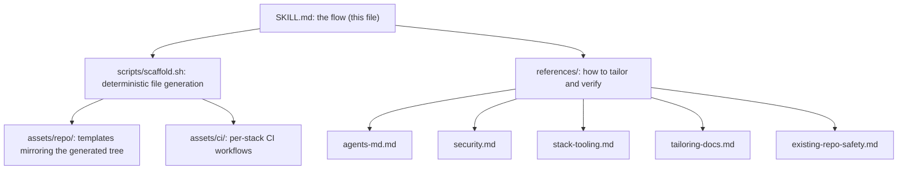
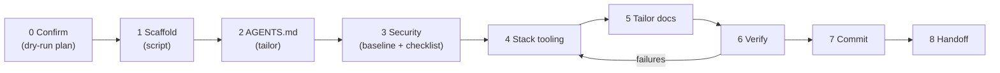

# Harness Repo: the right starter, every time

**Humans steer. Agents execute. This skill builds the scaffolding that makes that true.**

Goal: every new repo begins with the same legible, enforceable, secure foundation, so any
agent session can be productive and safe from the first prompt.

The approach follows OpenAI's
[harness engineering](https://openai.com/index/harness-engineering/) write-up on building with
Codex in an agent-first world: the repository is the system of record, `AGENTS.md` is a short
map rather than a manual, architectural rules are enforced mechanically, and plans are
versioned files. This skill is an independent, extended adaptation with a security baseline and
an idempotent scaffold. It is not an OpenAI product.

## Quick Reference

| Need | Read |
|------|------|
| Tailor the generated `AGENTS.md` | [`references/agents-md.md`](references/agents-md.md) |
| Security baseline and post-bootstrap checklist | [`references/security.md`](references/security.md) |
| Language manifests and the one `check` command | [`references/stack-tooling.md`](references/stack-tooling.md) |
| Make the seven docs describe this project | [`references/tailoring-docs.md`](references/tailoring-docs.md) |
| Re-running on a repo that already has files | [`references/existing-repo-safety.md`](references/existing-repo-safety.md) |

> **Diagram policy (non-negotiable):** every diagram, in this skill and in the generated
> repo, is **Mermaid** (a code fence labelled `mermaid`, or a `.mmd` file). Never ASCII art,
> PlantUML, or Graphviz. The generated linter (GP-3) enforces this.

`SKILL_DIR` = the directory containing this file. Paths below are relative to it.

## How the skill is organised



**Division of labour:** the script produces the identical, correct baseline (so nothing is
forgotten or improvised); *you* do the judgement work: tailoring AGENTS.md and docs to the
real project, creating the language manifests, and verifying everything runs.

## Input

<spec> $ARGUMENTS </spec>

Parse for: **name** (required slug), **stack** (`node|python|go|ruby|generic`, optional;
`typescript`/`fullstack` map to node), **description** (one sentence), **path** (parent dir,
default current directory). If the name is missing, ask:
> "What should the project be called? (optionally: stack, one-line description)"

## Flow



### Phase 0: Confirm intent

Run the script in dry-run mode and show the plan:

```bash
bash "$SKILL_DIR/scripts/scaffold.sh" --name <name> --stack <stack> --desc "<desc>" --path <parent> --dry-run
```

Print a confirmation block: project, stack, absolute path, description, and the
CREATE / SKIP / KEEP list from the dry run. Ask `Proceed? (yes / no / adjust)`. Wait. On
"adjust", re-parse and re-confirm. If the target already has files, read
[`references/existing-repo-safety.md`](references/existing-repo-safety.md) first.

### Phase 1: Scaffold (deterministic)

```bash
bash "$SKILL_DIR/scripts/scaffold.sh" --name <name> --stack <stack> --desc "<desc>" --path <parent>
```

This creates git (`main`), `AGENTS.md` + `CLAUDE.md`, the 7 `docs/` files and subfolders,
the initial exec-plan and plan template, the **security baseline**, `.opencode/` config and the
golden-principles linter, per-stack `ci.yml`, `dependabot.yml`, `.env.example`, `.gitignore`
(merged), and a `Makefile` for go/generic. Do not hand-write these; if a template is wrong,
fix the template in `assets/`. Add `--overwrite` only when the user asked for it.

### Phase 2: AGENTS.md (tailor the map)

The generated `AGENTS.md` is a correct generic base. Make it true for this repo by following
[`references/agents-md.md`](references/agents-md.md): verify every command, add the
what-this-is paragraph, add repo-specific boundaries and gotchas, keep the Mermaid diagrams,
stay under 150 lines. `CLAUDE.md` stays a one-line `@AGENTS.md` pointer.

### Phase 3: Security baseline

The files are already installed by Phase 1. Now follow
[`references/security.md`](references/security.md): tailor `docs/SECURITY.md` (threat model,
trust-boundary diagram, auth, data classes) and give the user the **post-bootstrap checklist**
(branch protection, secret scanning + push protection, Dependabot alerts, private vulnerability
reporting, read-only Actions token, CODEOWNERS). Never say those are enabled; they need a repo admin.

### Phase 4: Stack tooling

Create the language manifests and scripts so the commands in AGENTS.md and CI really work. See
[`references/stack-tooling.md`](references/stack-tooling.md). The contract is one `check`
command (lint + typecheck + tests) used everywhere.

### Phase 5: Tailor docs

Make `ARCHITECTURE`, `DESIGN`, `PRODUCT_SENSE`, `RELIABILITY`, and `QUALITY_SCORE` describe
this project, per [`references/tailoring-docs.md`](references/tailoring-docs.md). Prefer a
visible `TODO` over invented detail.

### Phase 6: Verify

Run, from the new repo, and fix until all pass:

```bash
node .opencode/tools/golden_principles.js   # GP-1..GP-7
<install command>                           # then
<check command>                             # lint + typecheck + tests
```

Then check the [Quality Bar](#quality-bar). Idempotency test: re-run the scaffold with the
same arguments; it must report `created=0 kept=0`.

### Phase 7: Commit

Preferred: re-run the scaffold with `--commit` only for a brand-new repo. Otherwise stage
**only the files you created or edited** (never `git add -A` on a pre-existing repo with unrelated
changes), review `git status`, and commit with a Conventional Commit:

```text
chore: bootstrap harness engineering structure

AGENTS.md map, docs/ knowledge base, security baseline, golden-principles linter,
per-stack CI, initial exec-plan. Humans steer. Agents execute.
```

### Phase 8: Handoff

Print a summary: project, path, stack, commit sha; a table of what was created
(AGENTS.md, CLAUDE.md, docs/, SECURITY files, CI, dependabot, linter, plan); the
verification results (linter exit code, `check` result); the **security checklist items the user
still must do**; and next steps:

1. Fill `.env` from `.env.example` (never commit it).
2. Fill CODEOWNERS and enable branch protection + GitHub security features.
3. Describe the first feature: write an exec-plan from `docs/exec-plans/_template.md`.
4. `pre-commit install` to enable local secret scanning.

## Quality Bar

All must be true before the handoff:

- [ ] `node .opencode/tools/golden_principles.js` exits 0
- [ ] `AGENTS.md` at root, under 150 lines, every command verified; `CLAUDE.md` points to it
- [ ] All 7 top-level docs exist; Mermaid diagrams only (no ASCII/PlantUML/DOT)
- [ ] `docs/SECURITY.md` tailored; root `SECURITY.md`, dependabot, pre-commit, PR template present
- [ ] `ci.yml` has `permissions:`, pinned versions, secret scan, and the `golden-principles` job
- [ ] Stack `install` and `check` commands run green locally
- [ ] Initial exec-plan present and linked from `docs/PLANS.md`
- [ ] No secrets or real `.env` committed; `.env.example` has placeholders only
- [ ] Re-running the scaffold reports `created=0 kept=0`
- [ ] Security checklist handed to the user, not claimed as done

If any item fails, fix it before the handoff summary.

## Anti-Patterns to Avoid

| Anti-pattern | Why it fails | Do this instead |
|--------------|--------------|-----------------|
| Hand-writing the baseline files | Drifts from the tested templates and forgets items | Run `scripts/scaffold.sh`; fix templates in `assets/` |
| A 400-line `AGENTS.md` manual | Agents lose the signal in the noise | Keep the map under 150 lines; link to `docs/` |
| Commands in `AGENTS.md` nobody ran | A wrong command is worse than none | Run every command; delete or mark `TODO` what does not exist |
| `git add -A` in a repo with unrelated changes | Sweeps user work into the bootstrap commit | Stage only the files the scaffold created |
| `--overwrite` by default | Destroys the owner's existing docs and CI | Default to KEEP; merge the `*.harness-new` proposals |
| Claiming branch protection or secret scanning is on | Only a repo admin can enable them | Hand over the checklist and say what is still open |
| ASCII or PlantUML diagrams | Fail the GP-3 linter and rot silently | Use Mermaid everywhere |
| Inventing architecture detail in the docs | Agents trust it and build on a lie | Leave a visible `TODO` |

## When to Use / Not Use

| Use this skill when | Do not use it when |
|---------------------|--------------------|
| Starting a new repo that agents will work in | You only need to edit one existing doc |
| Making an existing repo agent-ready (idempotent, KEEP by default) | The repo already has a mature harness and only needs a refresh; use a doc-gardening pass |
| Standardising `AGENTS.md`, `docs/`, CI, and a security baseline across projects | You need a framework app generator (Next.js, Rails, and so on); run that first, then this |
| The user says "harness engineering", "agent-first", or "bootstrap this repo" | The task is feature work inside an already-harnessed repo |

## Maintaining this skill

Change templates in `assets/`, never inline in a session. After editing, validate:
`scripts/scaffold.sh` into a temp dir for each stack, run the generated linter, re-run for
idempotency, and render every Mermaid block. Action and tool versions in `assets/ci/` and
`.pre-commit-config.yaml.tmpl` were checked against upstream releases on 2026-11-09; re-check
periodically (Dependabot keeps them current in generated repos).
