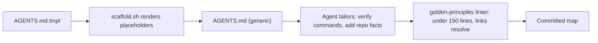
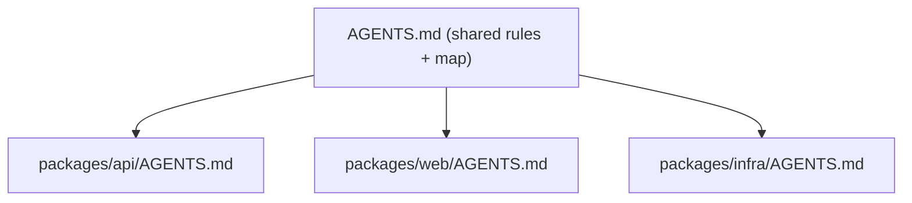

# Authoring AGENTS.md

`AGENTS.md` is the first file every agent reads in a new session. The scaffold writes a
solid base (`assets/repo/AGENTS.md.tmpl`); your job is to **tailor it so every command and
rule is true for this repo**. A wrong command in AGENTS.md is worse than none.

## What the scaffold gives you

| Section | Purpose |
|---------|---------|
| 1. Commands | Exact install / dev / build / test / lint / format / check commands |
| 2. Knowledge Map | Table + Mermaid map: which doc to read for which kind of change |
| 3. Boundaries | Always / Ask-first / Never rules (including security) |
| 4. Workflow | Mermaid SDLC state machine |
| 5. Conventions | Commits, tests, dependency policy, size budget |
| 6. Help Request | Standard format for escalating to a human |

`CLAUDE.md` is a one-line pointer (`@AGENTS.md`) so Claude Code and any
AGENTS.md-aware tool read the same single source of truth. Never duplicate content into it.

## Tailoring checklist (do all of these)

1. **Verify every command actually runs** (`{{INSTALL}}`, dev, build, test, lint, format, check).
   Replace guesses with what `package.json` scripts / `pyproject.toml` / `Makefile` really define.
   If a command does not exist yet, delete the line or write `# TODO: not configured`, never leave a fake.
2. **Add a one-paragraph "What this is"** under the title (from the user's description).
3. **Add repo-specific boundaries** discovered while exploring: generated files not to edit,
   directories that are frozen, required env vars, flaky tests, code-owner areas.
4. **Add stack gotchas** only if they are non-obvious and cost agents time (e.g. "run
   `make gen` after editing `.proto`"). One line each.
5. **Keep the Mermaid diagrams** and update the knowledge map if you add docs.
6. **Check the budget:** under 150 lines (GP-1). If it grows, move detail into `docs/` and link it.

## Rules for good AGENTS.md content

- **Map, not manual.** Link to docs; do not paste them.
- **Imperative and specific:** "Run `npm test -- --run` before committing", not "make sure tests pass".
- **Commands in code blocks**, exactly as typed, with what each does.
- **Boundaries over aspirations:** concrete Always / Ask / Never beat vague style advice.
- **Only facts an agent cannot infer from the code.** Do not restate what `ls` shows.
- **No secrets, no URLs with tokens, no personal data.**
- **Diagrams are Mermaid.** No ASCII trees or boxes (the linter fails them).

## Anti-patterns

| Anti-pattern | Fix |
|--------------|-----|
| 400-line wall of conventions | Split into `docs/DESIGN.md`, link it |
| Commands that no longer exist | Re-verify; wire a `check` script and CI to the same command |
| Instructions duplicated in CLAUDE.md, README, AGENTS.md | One source (AGENTS.md); others point to it |
| "Be careful with security" | Concrete rules in Boundaries, details in `docs/SECURITY.md` |
| Stale after refactors | Run the doc-garden skill after large changes |

## Monorepos

Keep the root `AGENTS.md` as the map plus shared rules. Add a short `AGENTS.md` inside each
package (`packages/api/AGENTS.md`) with only that package's commands and boundaries; the
nearest file wins. Each stays under the size budget and links back to the root.

