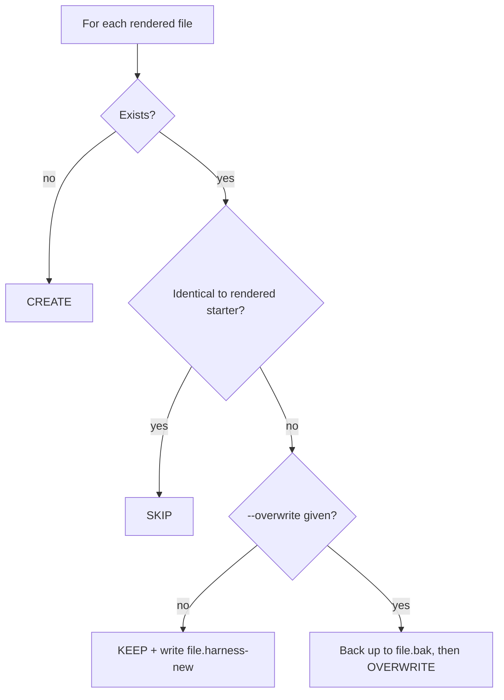

# Existing-Repo Safety (idempotent re-runs)

`scripts/scaffold.sh` is safe to run on a repo that already has content. For every file it
renders it applies one policy:

Rules:
- **Default is KEEP.** Never overwrite silently; overwrite only when the user explicitly asks.
- `.gitignore` is **merged** (missing entries appended), never replaced.
- Language manifests (`package.json`, `pyproject.toml`, ...) are not touched by the script.
- `--commit` stages **only the files the script created/overwrote**, never `git add -A`,
  so unrelated work in a dirty tree is not swept into the bootstrap commit.
- `--dry-run` prints the CREATE/SKIP/KEEP plan and writes nothing. Always show it in Phase 0.
- Review each `*.harness-new` with the user, merge the useful parts, then delete the proposal
  (they are git-ignored so they cannot be committed by accident).
- A second run with the same arguments must report `created=0 kept=0`.

When the repo already has its own `AGENTS.md`/`CLAUDE.md`: keep theirs, read the proposal, and
merge in only the missing sections (Boundaries, security rules, knowledge map).
