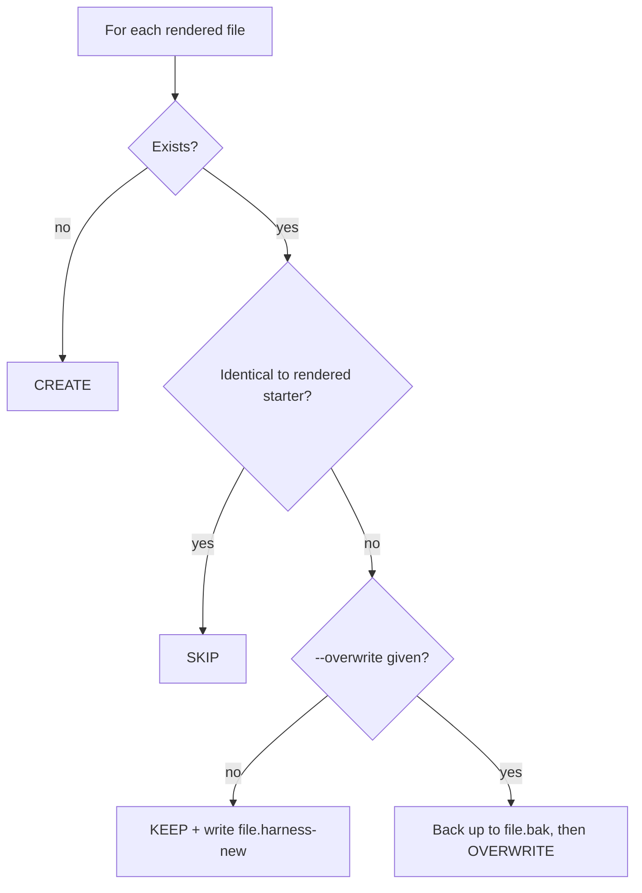

# Existing-Repo Safety (idempotent re-runs)

`scripts/scaffold.sh` is safe to run on a repo that already has content. For every file it
renders it applies one policy:

Rules:
- **Default is KEEP.** Never overwrite silently; overwrite only when the user explicitly asks.
- `.gitignore` is **merged** (missing entries appended), never replaced.
- Language manifests (`package.json`, `pyproject.toml`, ...) are not touched by the script.
- `--commit` stages **only the files the script created/overwrote**, never `git add -A`,
  so unrelated work in a dirty tree is not swept into the bootstrap commit.
- `--dry-run` prints the CREATE/SKIP/KEEP plan and writes nothing. Always show it in Phase 0.
- Review each `*.harness-new` with the user, merge the useful parts, then delete the proposal
  (they are git-ignored so they cannot be committed by accident).
- A second run with the same arguments must report `created=0 kept=0`.

When the repo already has its own `AGENTS.md`/`CLAUDE.md`: keep theirs, read the proposal, and
merge in only the missing sections (Boundaries, security rules, knowledge map).

## Adopting a repo that already has a harness

Repos bootstrapped by an earlier version of this approach usually differ from today's starter in
predictable ways. Treat the `*.harness-new` proposals as a checklist, not a replacement:

| Found in the repo | Why it matters | Do this |
|-------------------|----------------|---------|
| ASCII trees or arrow-line workflows in `AGENTS.md` or `docs/` (box characters, `A -> B -> C` in a text fence) | Fails GP-3 | Redraw each as a Mermaid `flowchart` or `stateDiagram-v2`; keep the meaning, drop the characters |
| `docs/exec-plans/active/` missing or empty, so Git drops the folder | The linter or later plans break on a fresh clone | Add `active/.gitkeep` (and `completed/.gitkeep`) |
| Plan index without completed history or dependencies | Agents cannot see what was done or what builds on what | Add Active and Completed tables with plan numbers and a `Depends on` column; backfill from `exec-plans/completed/` |
| Short plans with no commands, scope, or STOP rules | Executors improvise on risky work | Adopt the new `_template.md` sections for new plans; do not rewrite finished plans |
| A project-specific linter (for example `golden_principles.py` in a Python repo) | Two linters drift apart | Keep theirs if it covers GP-1..GP-7; otherwise add the missing checks to it. Do not install a second copy |
| `.js` linter left behind after the python stack gained a `.py` one | Dead file; CI may still need Node | Delete it only after CI, pre-commit, and `AGENTS.md` all call the `.py` file |

Never rewrite the owner's completed plans, status notes, or issue-tracker workflow (for example a
`bd` section in `AGENTS.md`). Merge structure; keep their history and conventions.

The scaffold skips the initial-setup plan when any `*initial-setup*.md` plan already exists under
`docs/exec-plans/`. If `docs/PLANS.md` was created fresh in that case, delete its `001: Initial setup`
row so GP-6 does not report a broken link.
