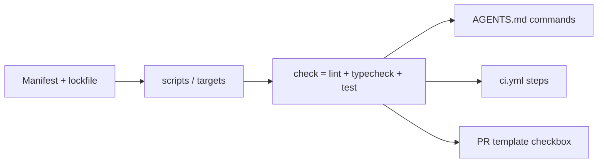

# Stack Tooling (after the scaffold)

The scaffold already wrote CI, `.gitignore`, dependabot, and (for go/generic) a `Makefile`. It
does **not** create language project files, because those need the user's real dependencies.
Create them now so the commands in `AGENTS.md` and `ci.yml` actually work. Only create what is
missing; never overwrite an existing manifest (merge scripts/entries instead).

Contract: the stack must expose `install`, `dev`, `build`, `test`, `lint`, `format`, and
a single `check` that runs lint + typecheck + tests. AGENTS.md, README, CI, and pre-commit
all call these same commands.

## node / typescript
- `npm init -y` (if no `package.json`); commit `package-lock.json`.
- Dev deps: `typescript eslint prettier vitest` (confirm with user for framework choices).
- Files: `tsconfig.json` (`"strict": true`), `eslint.config.js`, `.prettierrc`, `vitest.config.ts`.
- Scripts: `dev`, `build`, `test` (vitest), `lint` (eslint), `format` (prettier --write .), `check` = `npm run lint && npx tsc --noEmit && npm test`.
- Set `"engines": {"node": ">=22"}` to match CI.

## python
- `uv init` (or write `pyproject.toml`); commit `uv.lock` and `.python-version`.
- Dev group: `ruff pytest mypy`; add `[tool.ruff]` and `[tool.mypy] strict = true`.
- Make sure the package name matches the `dev` command in AGENTS.md (`uv run python -m <pkg>`).

## go
- `go mod init <module-path>`; the scaffold's `Makefile` already has `check`.
- Add `govulncheck` to CI once code exists.

## ruby
- `bundle init`; add `rubocop`, `rspec`; commit `Gemfile.lock`; add `.rubocop.yml` and `bin/dev`.

## generic / multi-stack
- Fill in the scaffold `Makefile` targets with the real commands (replace each `TODO`).
- If you add a language later, switch CI to the matching template from `assets/ci/`.

## Finish
After creating tooling: run `install`, then `check`. Fix until green. Update the commands in
`AGENTS.md` and `README.md` if any differ from the defaults.
